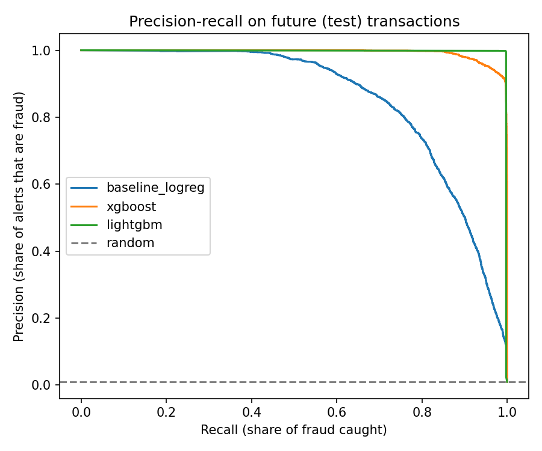
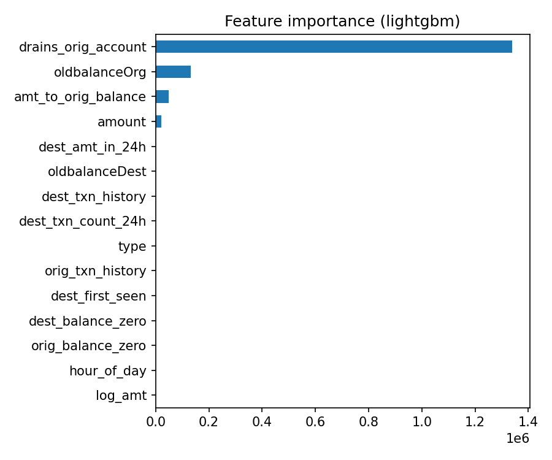

# E-wallet Fraud Detection with Google BigQuery

Flags fraudulent mobile-money transfers in 6.36 million e-wallet-style transactions (PaySim). Features are engineered in **BigQuery SQL**, models are trained in Python reading straight from BigQuery (a baseline, then XGBoost, then LightGBM), and the alert threshold is chosen by **business cost** rather than accuracy.

> Status: Phase 1 (data, features, models) done. Next: deployed scoring API, drift monitoring, LLM fraud-analyst agent.

## Results (test set = the most recent ~15% of hours)

| Model | PR-AUC | Recall @ 1% FPR | Fraud amount caught | False alarms |
|---|---|---|---|---|
| Existing rule (`isFlaggedFraud`) | _fill_ | _fill_ | _fill_ | _fill_ |
| Baseline (logistic regression) | _fill_ | _fill_ | _fill_ | _fill_ |
| XGBoost | _fill_ | _fill_ | _fill_ | _fill_ |
| LightGBM | _fill_ | _fill_ | _fill_ | _fill_ |
| *Leaky XGBoost (never deployed)* | _fill_ | _fill_ | _fill_ | _fill_ |

_Copy these from `outputs/metrics.csv` after training._

 

**In plain English:** _fill in after training, e.g. "The existing rule catches under 1% of fraud. LightGBM catches X% of fraudulent transfers (Y% of the money) with Z false alarms on the test period."_

## Architecture

```
Kaggle CSV → prep.py (Parquet parts) → BigQuery raw table → BigQuery SQL features → Colab: train + evaluate → models + metrics
```

## Key decisions

**1. Mule-style behavioural features in SQL**
Fraud in this data moves money out through TRANSFER and CASH_OUT, so the features focus on the receiving account: how many transactions it received and how much money in the previous 24 hours, its full history, and whether it has ever been seen before. Sender-side features include whether a transfer empties the account (`drains_orig_account`) and the amount relative to the balance.

**2. Preventing data leakage**
- **Only the past.** Window functions end at `1 PRECEDING` on the hour, so a transaction never sees itself, later transactions, or others in the same hour.
- **No post-transaction balances.** `newbalanceOrig` and `newbalanceDest` describe the account *after* the money has moved, but a real-time fraud check runs *before* it moves. A deliberately leaky model that uses them is trained only to show the effect, and it is never deployed.
- **Time-based split.** Train on the earliest ~70% of hours, tune on the next ~15%, test on the latest ~15%. A random split would let the model learn from the future.

**3. Choosing metrics**
Only ~0.3% of TRANSFER and CASH_OUT transactions are fraud, so accuracy is meaningless (predicting "legit" every time scores 99.7%). The project reports **PR-AUC** and **recall at a 1% false-positive rate**.

**4. Cost-based threshold**
Each missed fraud costs its amount, and each false alarm costs a fixed review cost (default 50, set with `--review-cost`). The threshold that minimises total cost is chosen on the validation period and reported once on the test period.

## Limitations (read before trusting the numbers)

- **PaySim is synthetic.** It's a simulator calibrated on real mobile-money logs, and its fraud follows a simple pattern (take over an account, transfer everything out, cash out). That makes it much easier to detect than real fraud, so near-perfect scores here would not carry over to production data.
- **The fraud rate drifts over time.** Legitimate activity thins out in the later hours of the simulation, so the test period has a higher fraud rate than training. A production system would need monitoring for this kind of drift (planned for Phase 2).
- **Same-hour activity is ignored** to keep the features leakage-safe, which loses some fast-moving signals.

## Run it

See [SETUP.md](SETUP.md). Everything is free with no credit card (BigQuery Sandbox + Google Colab).

## Data

PaySim: E. A. Lopez-Rojas, A. Elmir and S. Axelsson, *"PaySim: A financial mobile money simulator for fraud detection"*, 28th European Modeling and Simulation Symposium (EMSS), 2016. Downloaded from Kaggle (`ealaxi/paysim1`).

## Tech
Python, SQL, Google BigQuery, Google Colab, XGBoost, LightGBM, scikit-learn.
